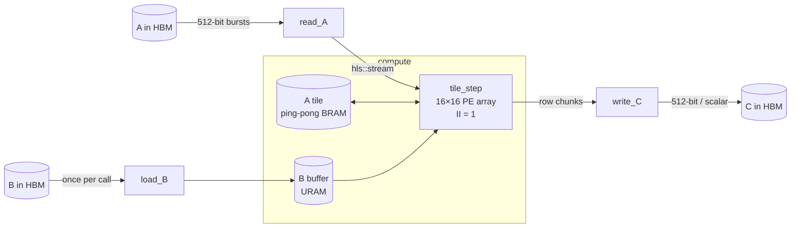

# FPGA GEMM Accelerator (Alveo U50)

A single-precision matrix-multiply (GEMM) kernel for the AMD/Xilinx **Alveo U50**, written in C++ with **Vitis HLS 2025.1**.
One bitstream handles every shape a small language model needs. It runs end-to-end inference of
**TinyStories-15M** ([llama2.c](https://github.com/karpathy/llama2.c)), with every matrix multiply offloaded to the FPGA.

```c
extern "C" void gemm(const float *A, const float *B, float *C, int M, int K, int N);
// C[M×N] = A[M×K] · B[K×N]   row-major fp32; M, K, N are runtime arguments
```

## Highlights

- **16 × 16 output-stationary PE array**: 256 fp32 multiply-accumulates per cycle. The array size is a compile-time knob (`-DGEMM_TN=32` gives 512 MAC/cycle).
- **Shift-chain accumulators.** Each PE interleaves 8 independent output rows through an 8-deep register chain. The 7-cycle fp32 adder latency is hidden, so the MAC loop runs at **II = 1** with no reduction tree.
- **Each input read from DRAM exactly once.** B stays resident in URAM, and A streams in over a 512-bit AXI port in long bursts.
- **Load/compute overlap.** A tiles are double-buffered. The next tile is pulled in with non-blocking FIFO reads inside the MAC pipeline itself.
- **Shape-generic.** It handles any `M ≥ 1`, `1 ≤ N ≤ 768` and `K ≤ 768`, from matrix-vector (`N = 1`, used for decoding) to square 768³.

## Architecture



The top level is an HLS `DATAFLOW` region with three concurrent processes connected by FIFOs:

| Stage | What it does |
|---|---|
| `read_A` | Streams A once, packing each row into 512-bit words. A wide path is used when `K % 16 == 0` and a packing path otherwise. |
| `compute` | Loads B into URAM, then calls `tile_step` once per 128-row tile of A. |
| `write_C` | Writes C with a 512-bit path when `N % 16 == 0`. Otherwise it uses a scalar path (e.g. `N = 1`) that has no multipliers or dynamic part-selects in its address logic. |

**Shift-chain PE.** A tile covers `TM × L = 16 × 8 = 128` rows of A. On cycle `(k, l)`, PE `(r, c)` adds
`A[l·TM + r][k] · B[k][jt·TN + c]` to the value leaving its 8-deep chain and pushes the result back in.
Each of the 8 slots belongs to a different output row, so a sum is only touched again 8 cycles later. That is longer than
the adder latency, which gives II = 1 without splitting any sum into partials. When a pass over K finishes, the
finished values fall out of the chain during the first 8 cycles of the next pass. They are captured into a small LUTRAM
buffer and drained to `write_C`, so the array never stalls between passes.

## Results

From the Vitis HLS synthesis report and the hardware link of the final design (default `TM = TN = 16`):

| Metric | Value |
|---|---|
| MAC loop initiation interval | **1** (target 1) |
| Kernel clock (achieved after place-and-route) | **245 MHz** (300 MHz target, auto-scaled by `v++`) |
| Peak compute | 256 MAC/cycle ≈ **125 GFLOP/s** at 245 MHz |
| DSP / LUT / FF | 1,291 (21%) / 145k (16%) / 240k (13%) |
| BRAM / URAM | 330 (12%) / 152 (23%) |

For the 768 × 768 × 768 case, the MAC pipeline runs 6 tiles × 48 column tiles × 768 × 8 ≈ 1.77 M cycles. That is about
**7.2 ms of compute at 245 MHz**, estimated from the cycle count rather than measured.

## Target workload

TinyStories-15M generates one token at a time. Each token costs 43 matrix-vector products (`N = 1`) of four shapes:

| Layer | M | K | Per token |
|---|:-:|:-:|:-:|
| attention q/k/v/o | 288 | 288 | 24 |
| feed-forward up | 768 | 288 | 12 |
| feed-forward down | 288 | 768 | 6 |
| classifier | 32000 | 288 | 1 |

At `N = 1` each weight is used once, so decoding is **memory-bandwidth-bound** and the kernel's job is to stream A as
fast as possible. Batched shapes (`N = 32`) and the square case reuse A across columns and are **compute-bound**, which
is where the PE array matters. See [docs/llm-background.md](docs/llm-background.md) for how the model calls the kernel.

## Building

Requires Vitis 2025.1, XRT, and the `xilinx_u50_gen3x16_xdma_5_202210_1` platform. Toolchain paths are set in
[`env.sh`](env.sh), and machine-specific overrides go in a gitignored `env.local.sh`.

```bash
make csim      # C simulation: all target shapes at N = 1 and 32, plus 768³ (seconds)
make csynth    # HLS synthesis -> build/hls/gemm.xo and build/hls/hls/syn/report/
make cosim     # C/RTL co-simulation on small shapes (minutes)
make hw_emu    # hardware-emulation xclbin (~5 min)
make hw        # full bitstream build/hw/gemm.xclbin (~1-3 h)
```

On a Slurm cluster, `./slurm.sh <target>` submits any of these as a batch job.

The testbench ([`src/kernel_tb.cpp`](src/kernel_tb.cpp)) checks every output against a double-precision reference
(tolerance `1e-2`).

## Repository layout

```
src/kernel.cpp        the accelerator (HLS C++)
src/kernel_tb.cpp     C-sim / co-sim testbench
hls_config.cfg        Vitis HLS settings (part, 300 MHz clock, testbench args)
Makefile              csim / csynth / cosim / hw_emu / hw flow
env.sh                toolchain environment
slurm.sh              run a make target as a Slurm job
scripts/              submit / status clients for the course's hardware grader
docs/                 background on the LLM workload
```

## Development history

The commit log follows the design from a naive triple loop to the final array:

1. Naive kernel → split accumulators to break the fp32 add dependency, plus loop flattening.
2. Dataflow restructure: A streamed once, B in URAM.
3. 16 × 16 output-stationary PE array with shift-chain accumulators.
4. Ping-pong A buffers, overlapping tile loads with compute.
5. Timing closure: removed the multiplier/part-select path in `write_C`, made the array size configurable, and dropped the unused fallback.

## Acknowledgements

Built as a mini-project for **CS2401** at IIIT Hyderabad. The course provided the build flow (Makefile, `env.sh`,
`slurm.sh`), the testbench, the grader scripts and the problem statement. The kernel design and implementation in
`src/kernel.cpp` are my own.
